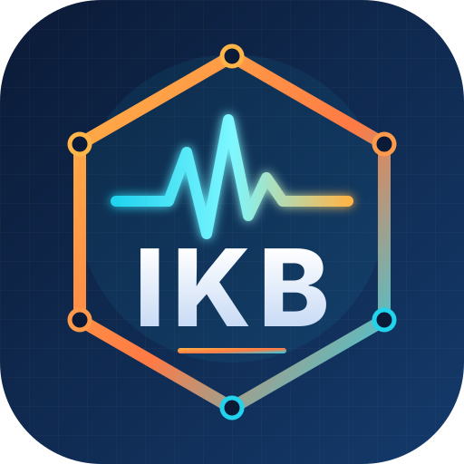
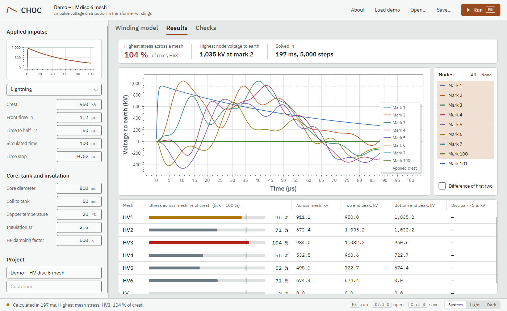
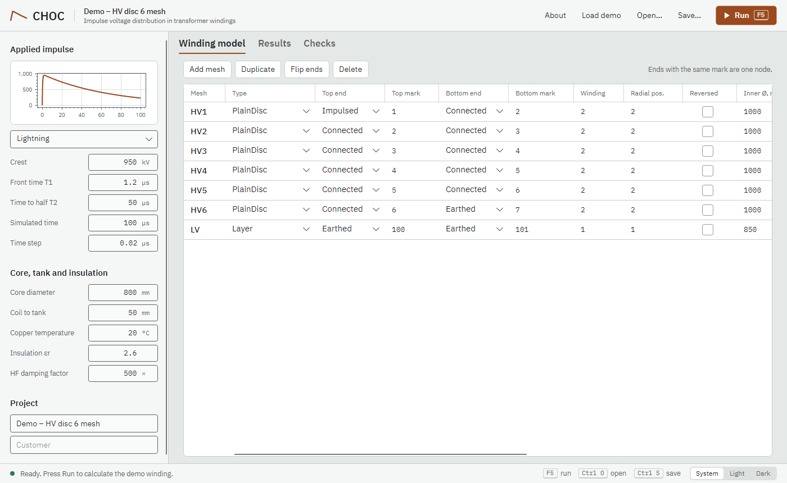
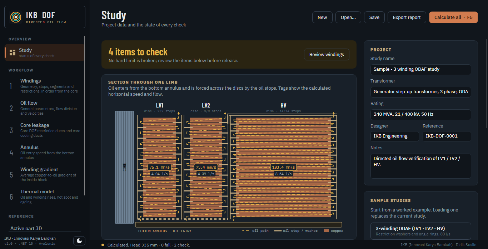
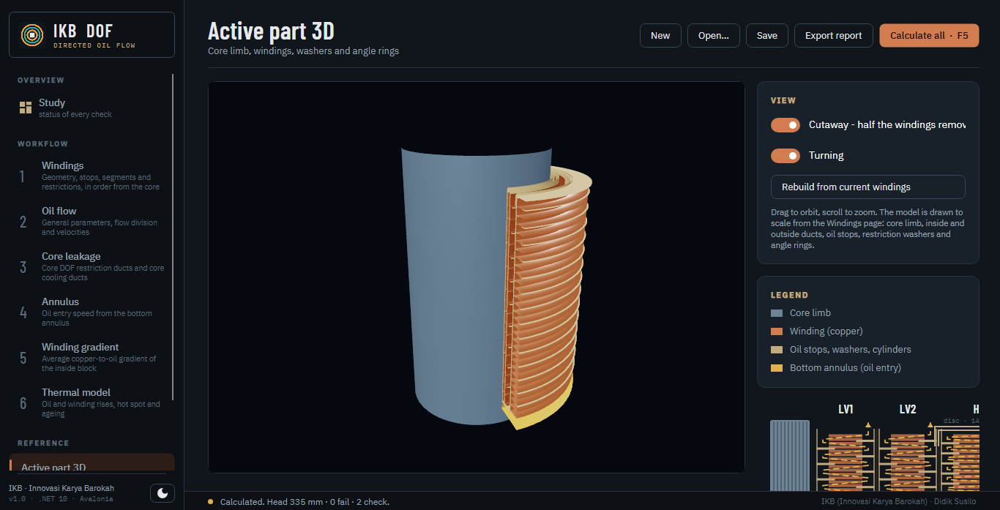
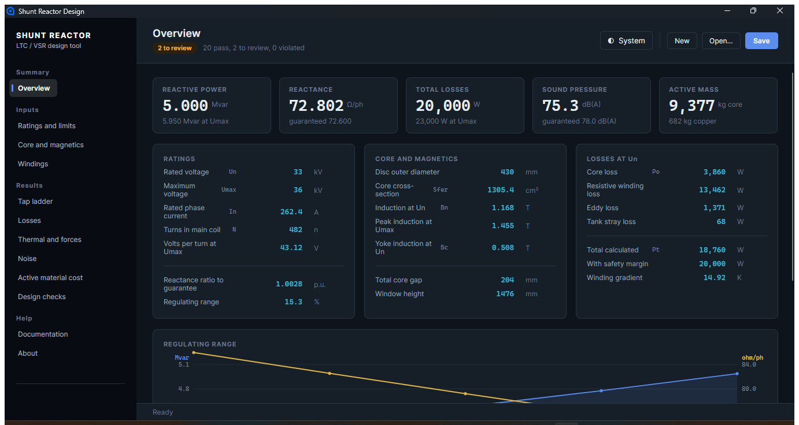
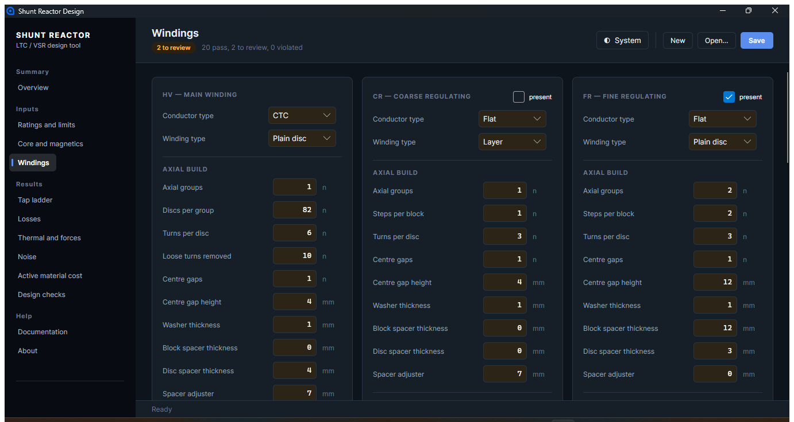
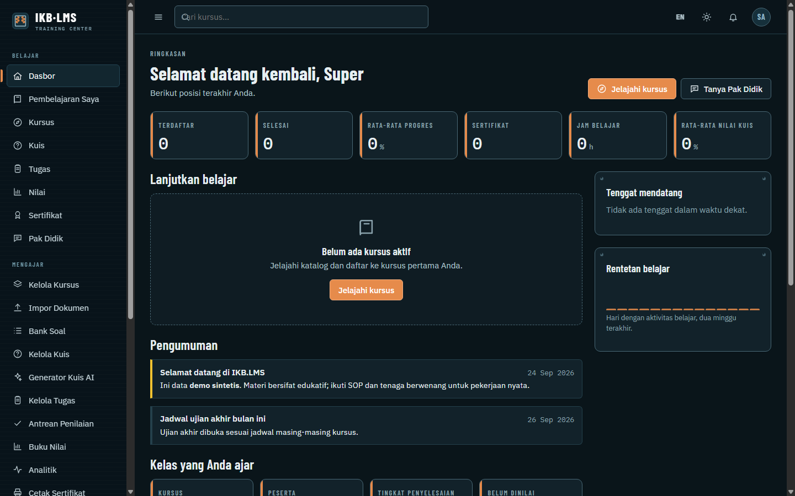
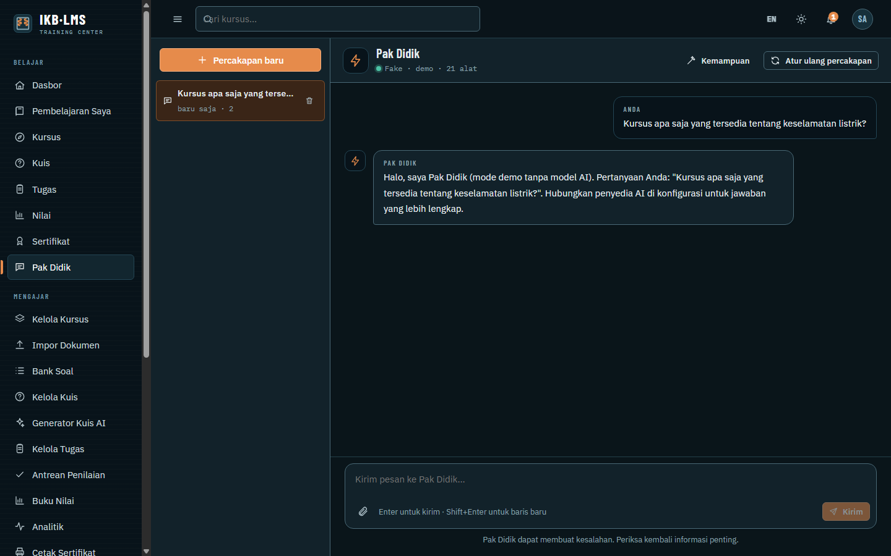

  

<h1 align="center">IKB · Innovasi Karya Barokah</h1>

  <b>Perangkat rekayasa digital untuk trafo daya dan reaktor shunt, beserta platform pelatihan dan AI pendukungnya.</b>

  <a href="README.md">English</a> · <b>Bahasa Indonesia</b>

  
  
  
  
  

---

IKB membangun pengganti modern lintas platform untuk program perhitungan dan spreadsheet yang dipakai
dalam desain trafo. Setiap aplikasi mempertahankan metode rekayasa dari program aslinya, memindahkannya
ke mesin perhitungan yang teruji, lalu menambahkan antarmuka desktop dengan pemeriksaan aturan desain,
grafik, dan laporan.

IKB dipimpin oleh **Didik Susilo**.

## Kalkulator rekayasa

| Solusi | Fungsi | Status |
|---|---|---|
| ⚡ **[IKB.CHOC](https://github.com/IKB-Bogor/IKB.CHOC)** Distribusi tegangan impuls | Menghitung distribusi tegangan impuls petir dan surja hubung (*switching*) di sepanjang belitan trafo. Belitan dimodelkan sebagai sel *mesh* RLC (layer, helical, disc, interleaved, shield), bentuk gelombang dicocokkan dengan T1/T2, dan solver menampilkan tegangan tiap node, kurva diferensial, serta tegangan puncak per *mesh*. Implementasi ulang program CHOC dengan .NET. | Sudah rilis: installer Windows, macOS, Linux |
| 🛢️ **[IKB.DOF](https://github.com/IKB-Bogor/IKB.DOF)** Verifikasi aliran minyak terarah | Memeriksa pendinginan ODAF/ODWF pada bagian aktif trafo: pembagian aliran minyak antar belitan, kecepatan di kanal dan lubang *washer*, kebocoran inti, kecepatan masuk dari *annulus*, gradien belitan, dan model termal (*hot spot*, penuaan). Setiap hasil dicek terhadap aturan DH-1-C-2-090/091/092. Dilengkapi gambar penampang yang langsung diperbarui, tampilan 3D bagian aktif, dan laporan HTML yang siap cetak. | Sudah rilis: installer Windows, macOS, Linux |
| 🌀 **[ShuntReactor](https://github.com/IKB-Bogor/ShuntReactor)** Desain reaktor shunt | Mendesain reaktor shunt tetap atau variabel (VSR) dengan inti bercelah, mulai dari rating hingga susunan celah inti, konstruksi belitan, rugi-rugi, gradien, kebisingan, dan biaya material aktif. Menggantikan workbook Excel 18 sheet dan menghasilkan nilai yang sama untuk seluruh 95 besaran yang dibandingkan pada desain acuannya. | Dalam pengembangan aktif |
| 🌡️ **[IKB.ODAF](https://github.com/IKB-Bogor/IKB.ODAF)** Kalkulator ODAF | Kalkulator untuk pendinginan trafo ODAF (*oil directed, air forced*). | Direncanakan |

## Platform

| Solusi | Fungsi |
|---|---|
| 🎓 **[IKB.LMS](https://github.com/IKB-Bogor/IKB.LMS)** Sistem manajemen pembelajaran | LMS berbasis Blazor Server untuk pelatihan trafo, sistem tenaga listrik, dan keselamatan kelistrikan. Mencakup kursus, kuis, ujian, buku nilai, dan sertifikat; impor kursus dari PDF, Word, PowerPoint, dan Excel; pembuatan kuis dan penilaian esai dengan AI yang selalu ditinjau instruktur; serta **Pak Didik**, asisten AI di dalam aplikasi. Mendukung OpenAI, Azure OpenAI, Gemini, Anthropic, DeepSeek, dan Ollama. |
| 🤖 **[IKB_AI](https://github.com/IKB-Bogor/IKB_AI)** Aplikasi AI | Aplikasi-aplikasi AI untuk IKB. |

## Tangkapan layar

### ⚡ IKB.CHOC: distribusi tegangan impuls

| Hasil: tegangan node dan tegangan per *mesh* | Model belitan |
|---|---|
|  |  |

### 🛢️ IKB.DOF: verifikasi aliran minyak terarah

| Ringkasan studi dengan gambar penampang | Bagian aktif dalam 3D |
|---|---|
|  |  |

### 🌀 ShuntReactor: desain reaktor shunt

| Ringkasan desain | Konstruksi belitan |
|---|---|
|  |  |

### 🎓 IKB.LMS: sistem manajemen pembelajaran

| Dasbor | Pak Didik, asisten AI |
|---|---|
|  |  |

## Pendekatan bersama

- **Satu mesin perhitungan yang teruji.** Perhitungan ada di pustaka inti tanpa kode antarmuka, dan diverifikasi terhadap kasus acuan dari program atau workbook aslinya.
- **Pemeriksaan aturan desain.** Hasil dibandingkan dengan aturan desain dan ditampilkan sebagai PASS / CHECK / FAIL, lengkap dengan aturan dan bagian yang tidak lolos.
- **Lintas platform.** .NET 10 dengan Avalonia UI untuk desktop dan Blazor untuk web; installer mandiri yang tidak memerlukan runtime .NET.
- **Dua bahasa.** Dokumentasi tersedia dalam bahasa Inggris dan Bahasa Indonesia.
- **Lisensi terbuka.** Kalkulator dirilis dengan Lisensi MIT.

## Kontak

Pertanyaan atau kerja sama: buka *issue* di repositori yang bersangkutan.

© 2026 IKB – Innovasi Karya Barokah · Bogor, Indonesia

