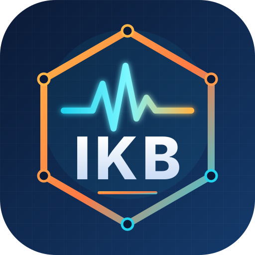
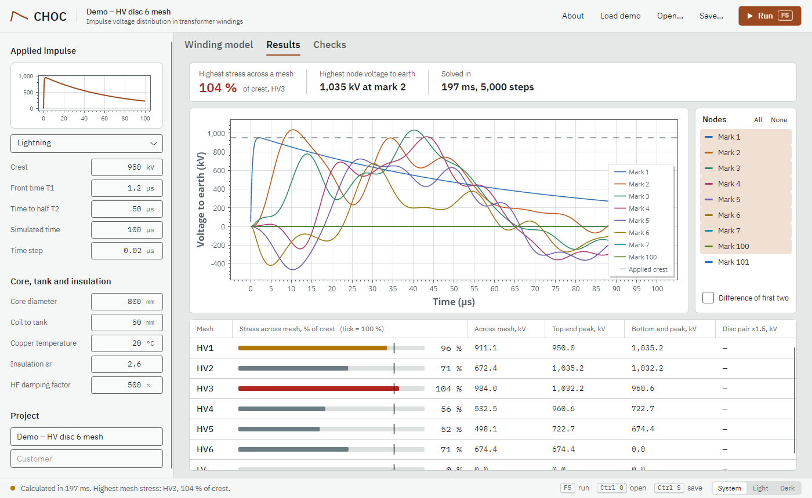
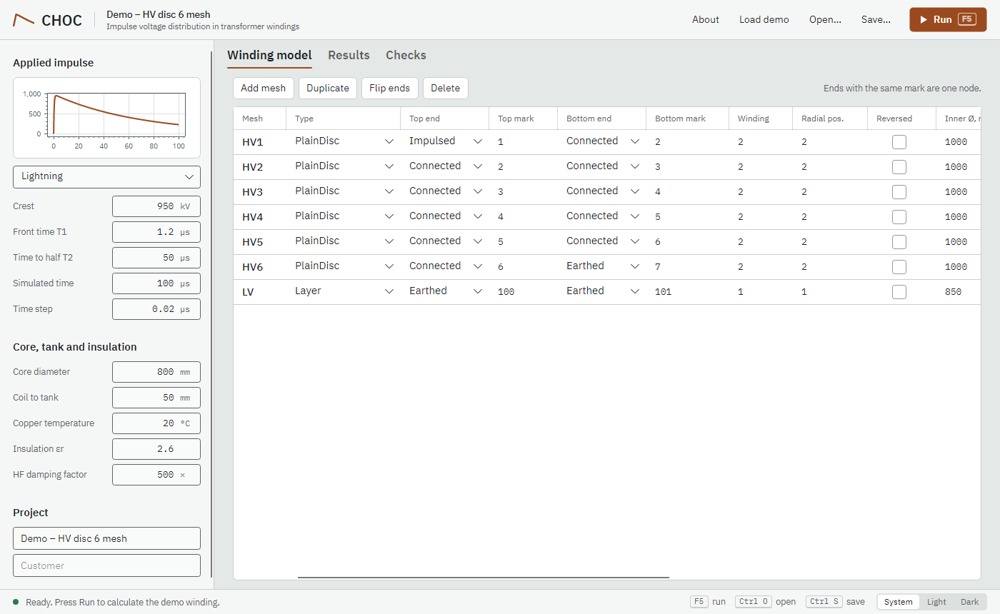
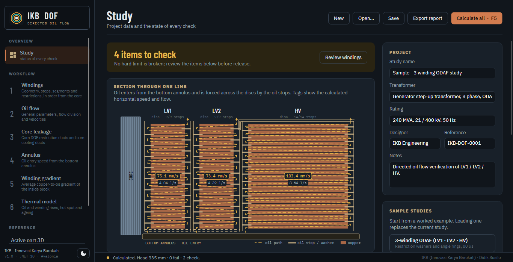
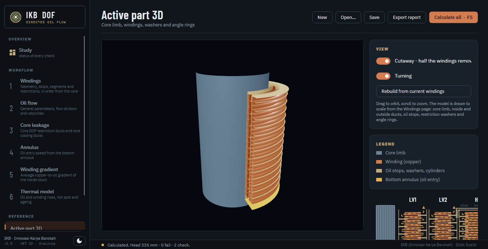
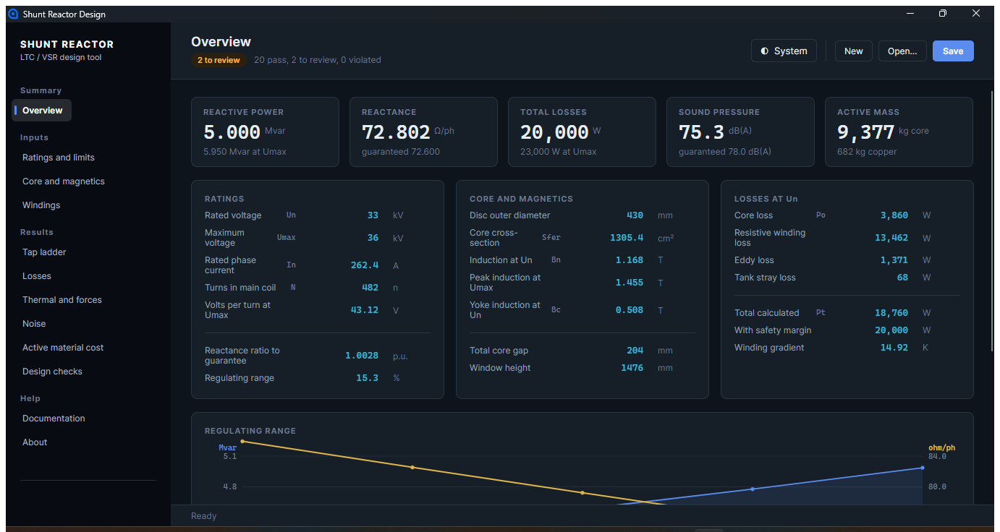
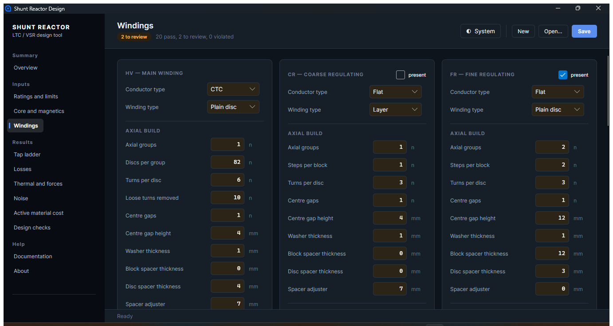
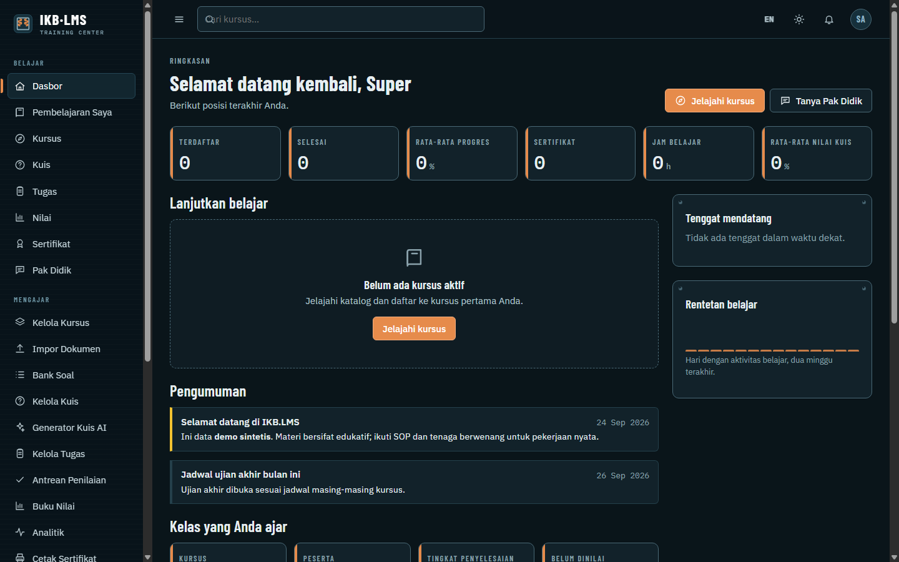
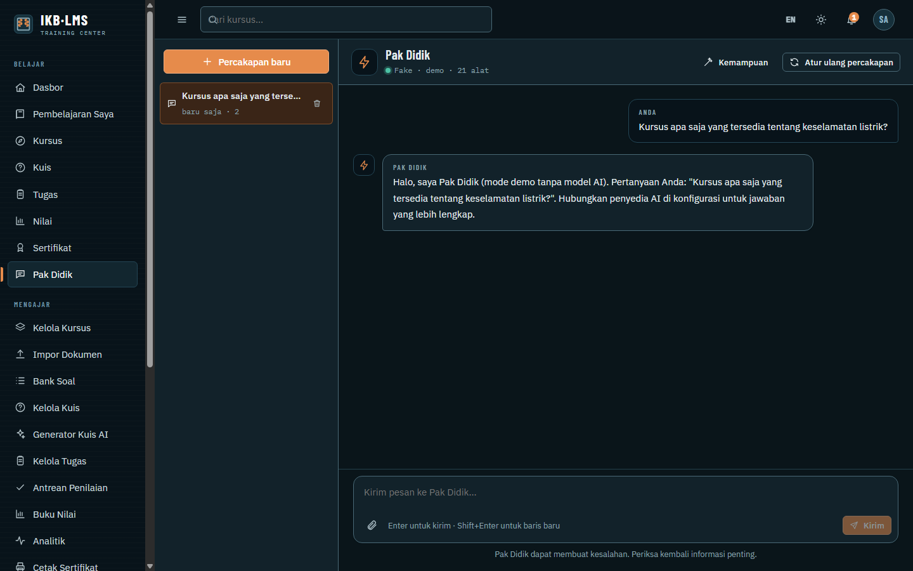

  

<h1 align="center">IKB · Innovasi Karya Barokah</h1>

  <b>Digital engineering tools for power transformers and shunt reactors, plus the training and AI platform around them.</b> 
  <i>Perangkat rekayasa digital untuk trafo daya dan reaktor shunt, beserta platform pelatihan dan AI pendukungnya.</i>

  
  
  
  
  

---

IKB builds modern, cross-platform replacements for the calculation programs and spreadsheets used in
transformer design. Each tool keeps the engineering method of the original, puts it in a tested
calculation engine, and adds a desktop interface with rule checks, charts and reports.

IKB is led by **Didik Susilo**.

## Engineering calculators

| Solution | What it does | Status |
|---|---|---|
| ⚡ **[IKB.CHOC](https://github.com/IKB-Bogor/IKB.CHOC)** Impulse voltage distribution | Calculates how lightning and switching impulses distribute along transformer windings. Windings are modelled as RLC mesh cells (layer, helical, disc, interleaved, shield), waves are fitted to T1/T2, and the solver reports node voltages, differential curves and peak stress per mesh. A .NET reimplementation of the CHOC program. | Released: Windows, macOS, Linux installers |
| 🛢️ **[IKB.DOF](https://github.com/IKB-Bogor/IKB.DOF)** Directed oil flow verification | Checks the ODAF/ODWF cooling of a transformer active part: oil flow split between windings, duct and washer velocities, core leakage, annulus entry speed, winding gradient and the thermal model (hot spot, ageing). Every result is checked against the DH-1-C-2-090/091/092 rules. Includes a live section drawing, a 3D active part view and a printable HTML report. | Released: Windows, macOS, Linux installers |
| 🌀 **[ShuntReactor](https://github.com/IKB-Bogor/ShuntReactor)** Shunt reactor design | Sizes a fixed or variable (VSR) gapped-core shunt reactor from ratings to core gap ladder, winding build, losses, gradient, noise and active material cost. Replaces an 18-sheet Excel workbook and matches all 95 compared quantities of its reference design. | Active development |
| 🌡️ **[IKB.ODAF](https://github.com/IKB-Bogor/IKB.ODAF)** ODAF calculator | Calculator for oil-directed, air-forced (ODAF) transformer cooling. | Planned |

## Platforms

| Solution | What it does |
|---|---|
| 🎓 **[IKB.LMS](https://github.com/IKB-Bogor/IKB.LMS)** Learning management system | Blazor Server LMS for transformer, power system and electrical safety training. Courses, quizzes, exams, gradebook and certificates; course import from PDF, Word, PowerPoint and Excel; AI quiz generation and essay grading that an instructor always reviews; and **Pak Didik**, an in-app AI assistant. Supports OpenAI, Azure OpenAI, Gemini, Anthropic, DeepSeek and Ollama. |
| 🤖 **[IKB_AI](https://github.com/IKB-Bogor/IKB_AI)** AI apps | AI applications for IKB. |

## Screenshots

### ⚡ IKB.CHOC: impulse voltage distribution

| Results: node voltages and stress per mesh | Winding model |
|---|---|
|  |  |

### 🛢️ IKB.DOF: directed oil flow verification

| Study overview with live section drawing | Active part in 3D |
|---|---|
|  |  |

### 🌀 ShuntReactor: shunt reactor design

| Overview of the design | Winding build |
|---|---|
|  |  |

### 🎓 IKB.LMS: learning management system

| Dashboard | Pak Didik, the AI assistant |
|---|---|
|  |  |

## Shared approach

- **One engine, tested.** Calculations live in a core library without UI code and are verified against reference cases from the original program or workbook.
- **Rule checks.** Results are compared with the design rules and shown as PASS / CHECK / FAIL with the rule and the part that failed.
- **Cross-platform.** .NET 10 with Avalonia UI for desktop and Blazor for web; self-contained installers that need no .NET runtime.
- **Bilingual.** Documentation in English and Bahasa Indonesia.
- **Open license.** The calculators are released under the MIT License.

## Contact

Questions or collaboration: open an issue in the relevant repository.

© 2026 IKB – Innovasi Karya Barokah · Bogor, Indonesia

